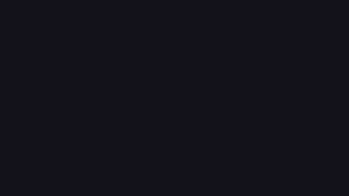
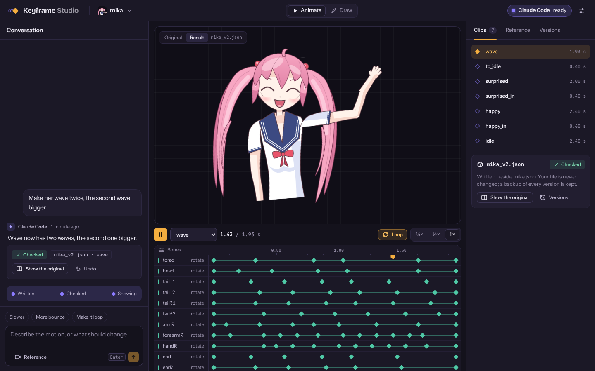
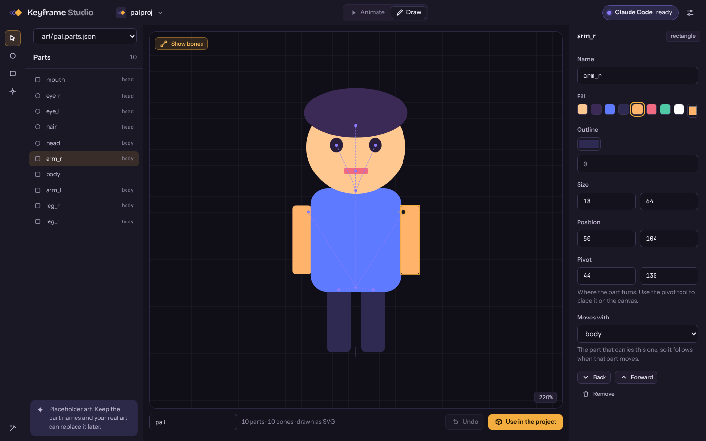
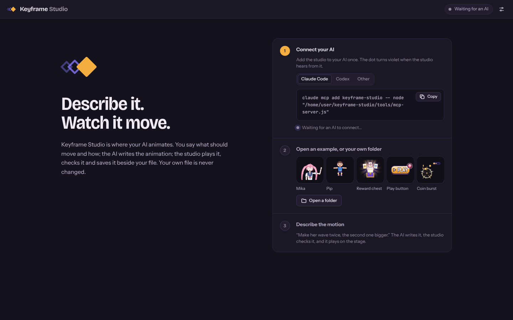
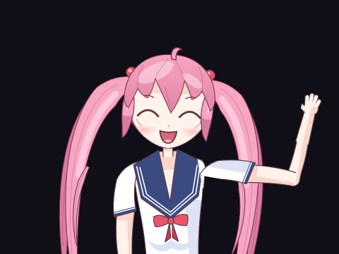
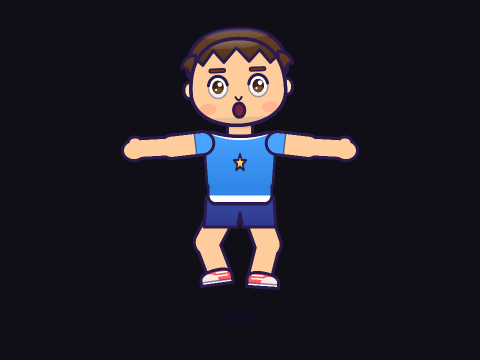
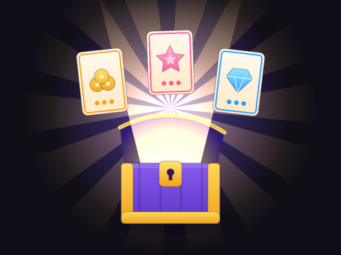
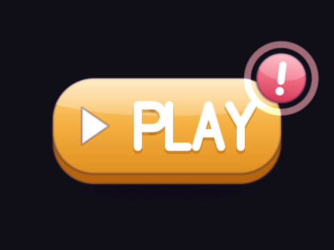
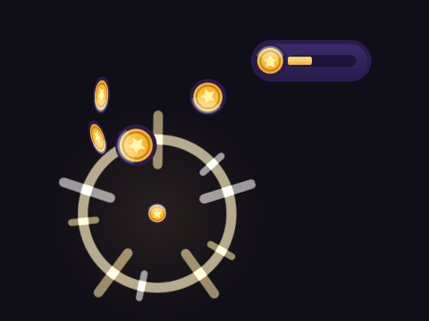

<p align="center">
  
</p>

<h3 align="center">Describe it. Watch it move.</h3>

<p align="center">
  An open-source, AI-assisted 2D skeletal animation studio.<br>
  You say what should move and how; your AI writes the animation; the studio plays it, checks it and saves it beside your file.
</p>

<p align="center">
  <a href="LICENSE"></a>
  
  
  
  
</p>

<p align="center">
  
</p>

> **Beta.** This is the first public release. It works end to end and every part is tested, but
> expect rough edges. Your own files are never changed, so trying it is safe.

## What it does

Any capable model can write animation data today. What it cannot do on its own is see the
result, prove the file opens and plays, or keep the animator's work safe. Keyframe Studio does
those things for whichever AI you use:

- **Describe it in plain words.** "Make her wave twice, the second wave bigger." The AI reads the
  rig, writes the clip, and the stage plays it a minute later.
- **It understands what it animates.** A character, a prop, a UI button or an effect each get the
  timing that suits them. The animation principles (anticipation, ease, overshoot, overlap,
  squash with volume kept, holds) are built in as rules with numbers, and every clip is measured
  against them.
- **Done means seen and checked.** The studio renders frames for the AI to look at, checks that the
  file loads and plays, and critiques the motion before anything is called finished.
- **Your file is never touched.** Every result is a new file beside yours, with a backup of every
  version and one-click undo.
- **Draw when there is no art yet.** Draw mode builds placeholder parts, pivots and bones in the
  page, or the AI draws them as SVG; either way you get a rig the studio can animate at once.
- **Effects.** Bursts, trails, flashes, glows and shakes, written as ordinary bones and keys so
  every engine plays them.
- **Learn from a reference video.** Mark one element in a screen recording; the studio measures its
  motion and puts it on a bone of your rig, then compares the two side by side.
- **Its own engine.** The studio plays and writes the Spine 4.2 JSON format on its own engine, with
  no Spine code and no Spine license. The official Spine runtime is an opt-in add-on.
- **Take it anywhere.** A Godot 4 add-on imports the animation as Godot's own Skeleton2D and
  AnimationPlayer, and a single HTML file plays it with no studio at all.

The opening above was made the same way: the studio drew the mark as parts, wrote the motion,
checked and critiqued it, and exported it as one HTML file
([`docs/brand/intro.html`](docs/brand/intro.html), download and double-click). Its source is in
[`examples/opening`](examples/opening).

<table>
  <tr>
    <td width="50%"></td>
    <td width="50%"></td>
  </tr>
  <tr>
    <td align="center">Draw mode: parts, pivots and bones</td>
    <td align="center">The first run</td>
  </tr>
</table>

## Quick start

You need [Node.js](https://nodejs.org) 18 or newer. There is nothing to install: the studio has no
runtime dependencies.

```bash
git clone https://github.com/Zeatrex01/keyframe.git
cd keyframe
npm start
```

On Windows you can double-click `Start Studio.cmd` instead. The studio opens in its own window.
Pick an example (Mika is a good first one), connect your AI, and describe a motion.

## Connect your AI

There are two ways, and you can use both.

**The built-in Director.** If you have [Claude Code](https://claude.com/claude-code) installed and
signed in, open **Settings → AI connection** and choose it for the Director. You then talk to it in
the studio's own chat panel: it streams what it is doing, shows each step, and has a Stop button.
It runs with only the studio's tools, in the project folder, and never sees your personal
instruction files, hooks or memory. Codex CLI and Gemini CLI work the same way (best effort).
Details: [`docs/agents.md`](docs/agents.md).

**Any MCP client.** Claude Code, Codex, Gemini CLI, Cursor, VS Code, Windsurf, Claude Desktop or any
other client that speaks MCP. Add the studio once:

```bash
claude mcp add keyframe-studio -- node "/path/to/keyframe-studio/tools/mcp-server.js"
npm run connect        # prints the line for every client, with this checkout's path filled in
```

Settings in the page shows the same lines with copy buttons, and checks the connection. Ask the AI
to call `start_here` first: it returns the project's state, the order of work and the next call.
The first session, step by step: [`docs/getting-started.md`](docs/getting-started.md).

## Examples

Five examples open as copies, so you can ask for changes freely.

| | | | | |
|:-:|:-:|:-:|:-:|:-:|
|  |  |  |  |  |
| **Mika**<br>character | **Pip**<br>character on IK | **Reward chest**<br>prop | **Play button**<br>UI | **Coin burst**<br>effect |

## Bring your own rig

Put a skeleton into a project folder: a Keyframe file, or a Spine 4.2 JSON export with its atlas
and PNG. It appears on the stage by itself. [`docs/character-template.md`](docs/character-template.md)
says how to draw and name a character so face clips, body clips and follow-through work on it
straight away. No art yet? Use Draw mode, or ask the AI to draw placeholder parts.

## Godot

[`integrations/godot`](integrations/godot) is a Godot 4 add-on. `npm run godot -- <skeleton.json>`
(or the `export_godot` tool) writes a `.kfscene`; the add-on imports it as Skeleton2D, Bone2D,
Polygon2D and an AnimationPlayer with Godot's own tracks, so you keep editing it in Godot's
animator. A demo project is included. See [`docs/godot.md`](docs/godot.md).

## Spine

The studio reads and writes the Spine 4.2 JSON format for everyone, with no Spine code. The
**Spine add-on** is different: it brings Esoteric Software's official Spine runtime, for physics,
transform and path constraints, binary `.skel` files and the official verdict beside the studio's
own. That runtime is under the [Spine Runtimes License](https://esotericsoftware.com/spine-runtimes-license),
so **you need your own Spine Editor license to use it**. It is not in this repository and is off by
default. Only when you turn it on in Settings (or run `npm run spine-addon -- --accept-license`)
does the studio download it from Esoteric Software's npm package into your app data. Turning it off
deletes it. See [`NOTICE`](NOTICE) and [`docs/addons.md`](docs/addons.md).

## Tools

Twenty-nine tools are served to the AI by default: art direction (a style guide), draw, critique
and export art, read, brief, write, effects, check, critique motion, see, measure, undo, bake, paint
weights, converse, and learn from a reference. More are
available with `--all`. Every tool explains itself (when to use it, every argument, a worked
example, what comes next), so any model can use them without help.
The full list, written from the definitions: [`docs/tools.md`](docs/tools.md).

The same tools work without an MCP client, one call at a time:

```bash
node tools/cli.js list
node tools/cli.js see_animation --project <folder> --args '{"animation":"idle"}' --out idle.png
```

## Configuration

Command-line flags win over environment variables.

| Setting | Where | Default | What it does |
|---|---|---|---|
| `--project <folder>` | `studio.js`, `mcp-server.js` | the project open last | the folder to work on |
| `--port <n>` / `KS_PORT` | `studio.js` | `8731` | the page's port (always on 127.0.0.1) |
| `--open` | `studio.js` | off | open the page in its own app window |
| `--all` | `mcp-server.js` | off | also serve the shelf tools |
| `--only <tool,tool>` | `mcp-server.js` | off | serve exactly these tools (the built-in Director uses it) |
| `KS_LOG_LEVEL` | both | `info` | `error`, `warn`, `info`, `debug` or `silent` |
| `KS_LOG_FORMAT` | both | `text` | `json` writes one object per line |
| `KS_CONFIG` | both | `studio.config.json` in the checkout | the file that remembers projects |
| `KS_DATA_DIR` | packaged builds | per-user app data | where a packaged build keeps its config and logs |
| `KS_LIBRARY` | both | per user | where learned motions are kept |
| `KS_SPINE_RUNTIME` | both | the app data folder | where the Spine add-on keeps the official runtime |
| `KS_AGENT_CLAUDE`, `KS_AGENT_CODEX`, `KS_AGENT_GEMINI` | `studio.js` | found on `PATH` | the agent CLI the Director drives |
| `KS_AGENT_TIMEOUT_MS` | `studio.js` | `1200000` (20 min) | the longest one Director run may take |

Optional programs, found on the `PATH`: `ffmpeg` (reference videos), `yt-dlp` (video links) and
the Spine editor's CLI. Without them the studio works, and the feature that needs one says how to
install it.

## Troubleshooting

- **Another program uses port 8731**: the studio moves to the next free port by itself and prints the address. With `--port` (or `KS_PORT`) it uses exactly that port.
- **The page says no AI is connected**: the AI's MCP server must point at this checkout's
  `tools/mcp-server.js`. Settings shows the exact line and a connection check.
- **The Director does not start**: install Claude Code and run `claude` once in a terminal to sign
  in. Settings says what it found.
- **A reference video does not play or measure**: install `ffmpeg` and restart the studio.
- **Something else**: start with `KS_LOG_LEVEL=debug`, read the console window, and open an issue
  with those lines (without private paths).

## Roadmap

The studio grows in phases: tools any AI can use, its own engine, understanding the subject,
drawing and effects, and the app itself. All five are in this beta. What comes next (a web-only
studio, open 2D asset packs, an editor panel inside Godot) is in [`docs/roadmap.md`](docs/roadmap.md).

## Contributing

Contributions are welcome. [`CONTRIBUTING.md`](CONTRIBUTING.md) explains the setup and the one rule
that matters most: every change comes with a test that fails without it.
[`docs/architecture.md`](docs/architecture.md) describes how the parts fit together, and
[`docs/development.md`](docs/development.md) the workflow.

```bash
npm test            # every gate, no install needed
npm run check       # plus lint and the type check (after npm ci)
npm run test:e2e    # the core flow in a headless Chrome
```

## Security

The page answers on `127.0.0.1` only, refuses other sites and other host names, and never writes
your source files. It has no login, so do not expose it to a network. See
[`SECURITY.md`](SECURITY.md) for how to report a vulnerability.

## License

[MIT](LICENSE). Everything the studio needs to run is MIT, including its engine. The optional Spine
add-on is downloaded separately under its own license (see [Spine](#spine)). Bundled art and
asset packs list their licenses in [`NOTICE`](NOTICE).
